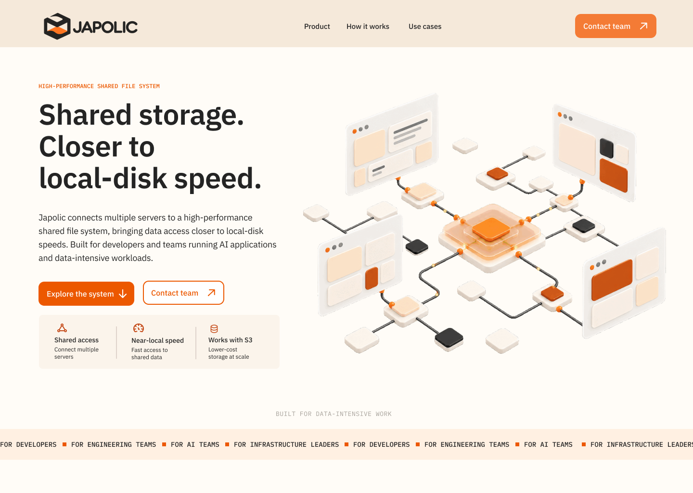

# Japolic — Responsive Website Design Concept

A Figma website design exploring how to communicate a technical storage product through a warm, clear visual direction.

**Designer:** Dulangika Chathurani Malankande  
**Project type:** Web design internship assessment concept  
**Tool:** Figma  
**Deliverables:** Web direction, desktop and mobile section designs, component variants, and a recorded walkthrough.

[View the Figma file](https://www.figma.com/design/Soqtl9kVF6aKN6jRt351c7/Japolic-%E2%80%94-Website-Direction---Landing-Page-%7C-Dulangika-Malankande?node-id=75-218) · [Watch the walkthrough](https://www.loom.com/share/edeeddc4a64549e081a041d27b589beb)

## The brief

Japolic is described in the assessment as a developer infrastructure company building a high-performance shared file system. It connects multiple servers to shared storage, offers access closer to local-disk speeds, and works with S3 to support lower-cost storage while keeping frequently used data fast and accessible.

The primary audience is developers, followed by engineering teams, AI teams, and infrastructure leaders.

The requested direction was **Classic · Warm · Trustworthy · Technical · Confident · Polished**, with references to early computing and engineering.

## My approach

I organized the page around a sequence: understand the product, explore storage challenges, review the capabilities, recognize relevant use cases, and contact the team.

The layouts vary between sections: a two-column hero, an interactive problem selector, a centered product illustration with four features, numbered use-case rows, and a contrasting closing call to action.

## Visual direction

**Warm engineering** combines clear typography, numbered technical labels, warm surfaces, and metallic illustrations.

| Role | Color |
|---|---|
| Main background | Warm ivory — #FFFCF7 |
| Actions and selected states | Signal orange — #EC5800 |
| Headings and dark surfaces | Graphite — #242424 |
| Supporting surfaces | Soft apricot — #FFF0E2 |
| Body text | Warm gray — #59514A |
| Borders and dividers | Sand — #DED4C8 |

**Typography:** IBM Plex Sans for headings, body text, navigation, and buttons; IBM Plex Mono for technical labels and numbering.

Illustrations use servers, files, and connecting paths as conceptual metaphors for software and shared data. They are not product screenshots or hardware specifications.

[View the web direction board](direction/web-direction.png)

## Desktop sections

| Section | Preview |
|---|---|
| Navigation and hero | [View](screens/desktop/01-hero.png) |
| Problem and solution | [View](screens/desktop/02-problem-solution.png) |
| Product features | [View](screens/desktop/03-product-features.png) |
| Use cases and value | [View](screens/desktop/04-use-cases.png) |
| Closing CTA and footer | [View](screens/desktop/05-footer.png) |

## Mobile adaptation

The mobile design reorganizes content rather than simply shrinking the desktop layout:

- The hero stacks its message, actions, and illustration vertically.
- Navigation uses a separate menu.
- The problem selector becomes an accordion with five states.
- Features form a two-by-two grid.
- Use cases and their illustrations stack vertically.
- Footer groups reorganize for a narrower screen.

| Section | Preview |
|---|---|
| Navigation and hero | [View](screens/mobile/01-hero.png) |
| Problem and solution | [View](screens/mobile/02-problem-solution.png) |
| Product features | [View](screens/mobile/03-product-features.png) |
| Use cases and value | [View](screens/mobile/04-use-cases.png) |
| Closing CTA and footer | [View](screens/mobile/05-footer.png) |
| Mobile menu | [View](screens/mobile/06-menu.png) |

## Components and interactions

The problem/solution component has five variants. Selecting a problem changes the matching solution content and selected state. The mobile version presents the same topics through an accordion.

- [Desktop component variants](components/desktop-problem-solution-variants.png)
- [Mobile accordion variants](components/mobile-accordion-variants.png)

The PNG exports document visual states; interactions are available in the Figma file and explained in the walkthrough.

## My contribution and AI assistance

I made and refined the layout decisions, desktop and mobile compositions, Figma components, and prototype interactions.

AI assistance supported research, brainstorming, copy exploration, inspiration, and illustrative assets.

## Scope and context

This repository documents a Figma design assessment concept. It does not contain a coded website or a launched product. Footer destinations and social icons represent proposed navigation; they are not verified official accounts.

This is not an official Japolic website. No open-source license is granted for the supplied brand or assessment materials. Please contact the designer before reusing the design.
